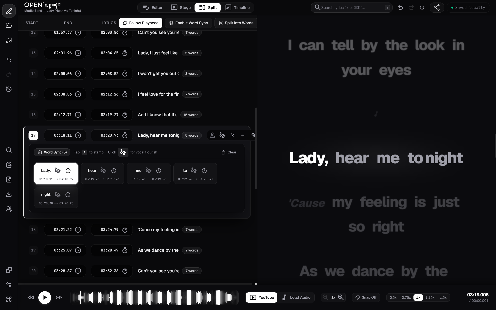

<div align="center">

# OpenLyryc

**Tap along to a song. Get synced lyrics.**

OpenLyryc is a browser studio for timing lyrics. Play a track, paste the words, and tap `Space` when each word is sung. Then export a lyric file or open the stage view.

[Open the studio](https://openlyryc.pages.dev) · [Docs](docs/README.md) · [Contributing](docs/CONTRIBUTING.md)

</div>

<p align="center">
  
</p>

## The short version

Timing lyrics by hand means typing `[00:12.34]` before every line and hoping it lands. OpenLyryc gives you a waveform, a playhead, and a spacebar.

You get:

- Word-by-word timing, not just line timing
- Syllable splitting for karaoke
- `.lrc` and `.ttml` export
- A full-screen stage view
- Chord sheets that follow the song

The editor runs in your browser. Audio files you open are not uploaded. A few optional features, like shared links and Unison Hub, talk to a server.

## Try it

The hosted version is at [openlyryc.pages.dev](https://openlyryc.pages.dev). The editor does not need an account.

Unison Hub is the community part: submissions, badges, and leaderboards. It needs an account and runs on a separate service.

## Run it locally

You need Node 20.9 or newer, npm 10 or newer, and git.

```bash
git clone https://github.com/aurostron/openlyryc.git
cd openlyryc
npm install
npm run build:packages
npm run dev
```

Open [http://localhost:3000](http://localhost:3000).

`npm run dev` starts the Next app, a small YouTube and SoundCloud proxy on port 3099, and a WebRTC signaling server on port 4444. The last two handle media lookups and live collab.

If you want shared preview links, copy `apps/web/.env.example` to `apps/web/.env.local` and fill in your own database. Everything else works without it.

## Project layout

```
apps/
  web/              Next.js app: studio, stage, lyrics, chords, karaoke
packages/
  schema/           lyric document types, LRC parser, SimHash
  sdk/              embed SDK for web, Android, and Tauri
  api/              Cloudflare Workers API (Hono)
docs/               format spec, API docs, architecture notes
scripts/            dev helpers
```

## File formats

| Format | Use it for |
| --- | --- |
| OpenLyrics JSON | The app's own document format |
| Enhanced LRC | Word-level timing in a `.lrc` file |
| Standard LRC | Spotify, VLC, foobar2000, most players |
| Apple TTML | Apple Music and broadcast tools |

The full syntax is in [docs/FORMAT_SPEC.md](docs/FORMAT_SPEC.md).

## What is not in this repo

Unison Hub's server, database, account system, and deployment setup are private. The client can talk to the hosted service, but you need an account to use it.

Some assets are also left out because we don't have the rights to share them. That includes the reaction-image avatar pack, the Alve Town pixel art, and the sample song. [docs/ASSETS.md](docs/ASSETS.md) explains what to use instead.

The production Cloudflare config and maintenance scripts are private too. You can build and run the app without them.

## Status

OpenLyryc is early. Things break. If you find a bug, open an issue with the song, browser, and what happened.

Found a security problem? Read [SECURITY.md](SECURITY.md) instead of opening a public issue.

Pull requests are welcome. Read [docs/CONTRIBUTING.md](docs/CONTRIBUTING.md) first.

## License

The code is MIT. The name and logo are not. Assets have their own terms, listed in [docs/ASSETS.md](docs/ASSETS.md).
